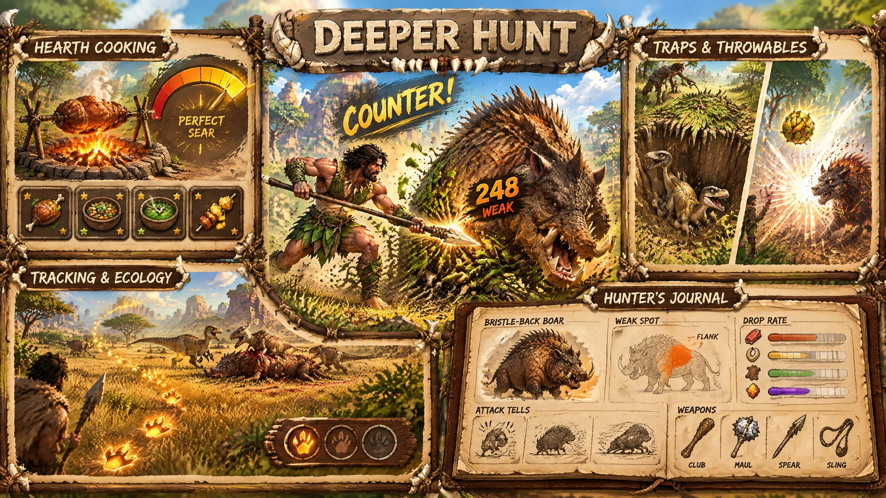

# Caveman vs Wild: "Deeper Hunt" Concept Proposal

This proposal adds five systems that turn a single fight into a full hunt cycle. You **prepare** a meal and traps, **track** a beast, **fight** it with a weapon class suited to it, **exploit** it with traps and throwables, and **learn** from it in the journal, which feeds back into the next hunt's preparation.

## Design pillars

| Pillar | What it means in play |
|---|---|
| **Preparation matters** | A good meal plus the right trap should make a hard beast feel fair; skipping them should feel risky. |
| **Every tell is an opportunity** | The telegraphs you already learn to dodge also tell you when to throw a flash pod or where to lay a snare. |
| **The island is alive** | Beasts leave tracks, hunt each other and feed on kills. You can use that: follow the tracks, or scavenge a predator's kill. |
| **Knowledge is power** | The journal records what you have observed, and every entry points at a concrete tactic. |

## 1. Hearth cooking

**Where:** a new **Cook** tab in the camp menu, available once the hearth is built (camp stage I).
**New ingredient:** **Raw Haunch** (`meat`), carved from Tuskhogs, Mudsnappers, Dunestalkers and Ashfangs.

| Meal | Ingredients | Buff |
|---|---|---|
| **Hearty Haunch** | Haunch ×2 | +25 max health |
| **Trail Stew** | Haunch ×1, Mendleaf ×2 | +30 max stamina, +20% stamina regen |
| **Snapper Broth** | Haunch ×1, Snapper Scale ×1, Mendleaf ×1 | Dodge costs 25% less stamina, +8% defence |
| **Brimstone Skewer** | Haunch ×1, Sulfur ×1 (stage II) | +12% attack, caldera heat drains 60% slower |

**Sear timing:** after picking a meal, a needle sweeps across a flame gauge and you press to stop it. Landing in the gold zone is a **Perfect** (150% duration), the green zone is **Good** (100%), and outside both it is **Charred** (60%). Only one meal is active at a time; the buff lasts 5 minutes (Perfect: 7.5 minutes) and ends early if you faint.

**Feedback:** sizzle and fat-pop particles at the hearth, a big "PERFECT SEAR" stamp, a buff icon with a countdown ring next to the health medallion, and a burst of warm sparks flying from the gauge to that icon.

## 2. Traps and throwables

This is a **gadget** slot shown above the hotbar. **G** uses the selected gadget and **C** cycles between them (d-pad down and up on gamepad).

| Gadget | Recipe | Carry | Effect |
|---|---|---|---|
| **Vine Snare** | Fiber ×3, Wood ×1 | 3 | Laid at your feet and armed after 0.6 s. The first beast to cross it is **held for 4 s** (bosses 2.5 s). A beast crossing it mid-charge is **tripped**: it topples for 3.5 s and takes +30% damage. |
| **Pitfall** | Wood ×3, Fiber ×2, Bone ×1 (stage II) | 2 | Dug in 1.2 s, then camouflaged. A beast that steps in **drops into the pit for 5 s** (bosses 3.5 s). This is the biggest punish window in the game. |
| **Flash Pod** | Glowcap ×1, Fiber ×1 | 5 | Thrown in an arc up to 14 m and bursts in a 7 m blinding flash. Beasts facing it are **blinded for 3.5 s** (they wander and their attacks miss). A beast caught in an **attack windup is interrupted and staggered** ("FLASH INTERRUPT"). |

**Counterplay rules:**
- Each boss grows **resistant** to a gadget type for 30 s after it triggers, so you can't chain one trap indefinitely.
- Only one pitfall can be placed at a time.
- Traps near camp cannot catch anything.

**New gather node:** **Glowcap** (luminous mushroom clusters) grows in the jungle shade and at the highland ruins.

**Feedback:** a snapping vine-whip plus leaf burst, dirt and plank debris when the pit collapses, a white-out flash with a screen bloom pulse, a trip slow-motion beat, and a "TRAPPED" or "TRIPPED" stamp.

## 3. Weapon classes

Every weapon now belongs to a **class** with its own moveset. The existing four tiers keep their class (club or maul), and two new classes are added.

| Class | Weapons | Moveset |
|---|---|---|
| **Club** | Knotted Club, Obsidian Greatclub | Fast: swings at 115% speed, 3-hit light combo, normal charged heavy. |
| **Maul** | Flint Maul, Amber Tusk Hammer | Slow: 85% speed, 1.3× motion values. A full charge (level 3) breaks poise for a guaranteed stagger. |
| **Spear** | **Bone Spear** (tier I), **Stalker Lance** (tier II) | Long reach (+1.6 m) in a narrow thrust arc. Heavy is a **lunge thrust** that travels 3 m. **Counter-thrust:** a light attack within 0.4 s of a *perfect dodge* makes a 2.2× crit thrust with slow-motion and a "COUNTER!" stamp. |
| **Sling** | **Reed Sling** (tier I), **Stalker Sinew Sling** (tier II) | Ranged. Light is a quick shot (18 m range, aimed at the lock-on target or where the camera looks). Heavy is a **charged whirl shot** (3 levels: more damage, more stagger, and a knockdown on a head hit). **Each shot costs 1 Stone**, which ties the sling to boulder mining. With no stones it swats for fist damage and shows an "Out of stones" tip. |

**Balance:** the sling deals less damage per hit but is safe. The spear rewards precise dodges. The maul rewards reading recovery windows. The club is the all-rounder.

**Feedback:** spear thrusts leave a narrow streak trail and the counter-thrust is a gold flash. Sling stones leave a dust contrail and crack on impact, and the charge whirl has a spinning ring.

## 4. Tracking and ecology

**Tracks:**
- Roaming beasts leave **footprints** on the terrain as they walk. The prints fade after about 90 s, and each species has its own print shape.
- Each spawn area also holds **clue spots**: dung piles, claw-scored rocks and shed scales. They are highlighted by a faint shimmer.

**Tracking meter:**
- Press **E** on a clue spot or on fresh prints to *study* it: +1 clue for that species, with a chime and scent motes.
- **3 clues** marks the species as **Tracked**. Its nearest living member gets a **map pin**, a **compass marker**, and a trail of **scent fireflies** drifting from you toward it.
- Tracking a species also fills in its journal habitat entry.

**Ecology (predators hunt herbivores):**

| Predator | Prey | Behaviour |
|---|---|---|
| Dunestalker | Tuskhog | When it isn't fighting you and a Tuskhog is within 24 m, it stalks the Tuskhog, pounces, and brings it down. |
| Mudsnapper | Tuskhog | Ambushes Tuskhogs that stray near the shoreline. |
| Ashfang | Dunestalker | Chases Dunestalkers at the highland–caldera border. |

- Prey **flees** at a sprint when a predator targets it.
- A predator that makes a kill **feeds** at the carcass for 12 s, head down and distracted. Hitting it while it feeds counts as a **sneak attack** (+50%).
- The carcass is **scavengeable**: 1 carve plus a chance of Raw Haunch.
- If you attack either beast, both switch to fighting you, which gives you a messy three-way fight.

## 5. Hunter's journal

A **Journal** tab in the satchel (**B** opens it directly). Each species page fills in as you observe, track, hunt and carve it.

| Knowledge | Unlocked by | Reveals |
|---|---|---|
| **Sighted** | Seeing it within 30 m | Name, title, region and portrait. Undiscovered species show a silhouette. |
| **Tracked** | Being marked Tracked (3 clues) | Habitat description and its predator or prey links. |
| **Weak spot** | Landing a weak-point hit, or hunting it once | Weak zone and multiplier, such as Tuskhog **flank ×1.35**. |
| **Hunted ×1** | 1 hunt | Attack list with a tell tip for each, plus its poise and toughness. |
| **Drops** | Each carved part is revealed as it is carved; after 3 hunts the exact rates are shown | Drop table with percentages. |
| **Records** | Ongoing | Number of hunts and your fastest hunt time. |

**Weak spots (new combat rule):** hits are classed as **head** (front 50° arc), **flank** or **rear** (back 50° arc) relative to the beast's facing. Each species has a weak zone that takes extra damage, shown by an orange "WEAK" damage number.

| Species | Weak zone | Multiplier |
|---|---|---|
| Tuskhog | Flank | ×1.35 |
| Mudsnapper | Head | ×1.3 |
| Dunestalker | Rear (tail) | ×1.3 |
| Emberbeetle | Rear (soft underside) | ×1.45 |
| Ashfang | Flank | ×1.3 |
| Ruinhorn | Rear (hind legs) | ×1.25 |
| Vulkarr | Head (glowing throat) | ×1.25 |

**Feedback:** a page-turn sound, ink-bleed reveal animation for new entries, a "Journal updated" toast with a quill spark, and a "!" badge on the satchel.

## New assets

| Asset | Source |
|---|---|
| Concept sheet (this document) | GPT Image |
| Painted icons: Raw Haunch, 4 meals, Vine Snare, Pitfall, Flash Pod, Glowcap, Bone Spear, Stalker Lance, Reed Sling, Sinew Sling, clue, journal | GPT Image (transparent) |
| Journal portraits (7 species) | Existing painted creature references, re-cropped |
| Spear and sling 3D models | Higgsfield image-to-3D from new GPT references, with procedural fallbacks |
| Trap, clue and footprint models | Procedural (vine loop and stakes, covered pit, glowing seed pod, dung and scored rock, per-species print decals) |
| SFX: sizzle, perfect sear, eat, snare snap, pit collapse, flash pop, sling whirl and release, stone crack, clue chime, tracked sting, page turn | Sound-effect generation |

Staged loading is unchanged: the gadget and spear SFX load with the coast stage, and highland-only content (Stalker Lance, Sinew Sling, pitfall) streams with the highlands stage.

## Controls

| Action | Keyboard / mouse | Gamepad |
|---|---|---|
| Use gadget (throw or lay) | G | D-pad down |
| Cycle gadget | C | D-pad up |
| Journal | B | Satchel, then the Journal tab |
| Study tracks or clue | E | B |
| Sling shot / charged whirl | Left click / hold right click | X / hold Y |
| Counter-thrust (spear) | Light attack just after a perfect dodge | X |
