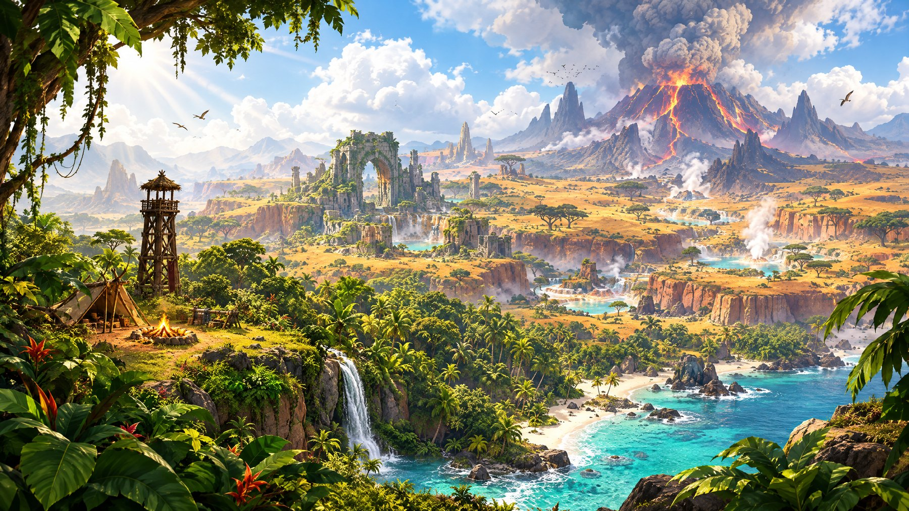
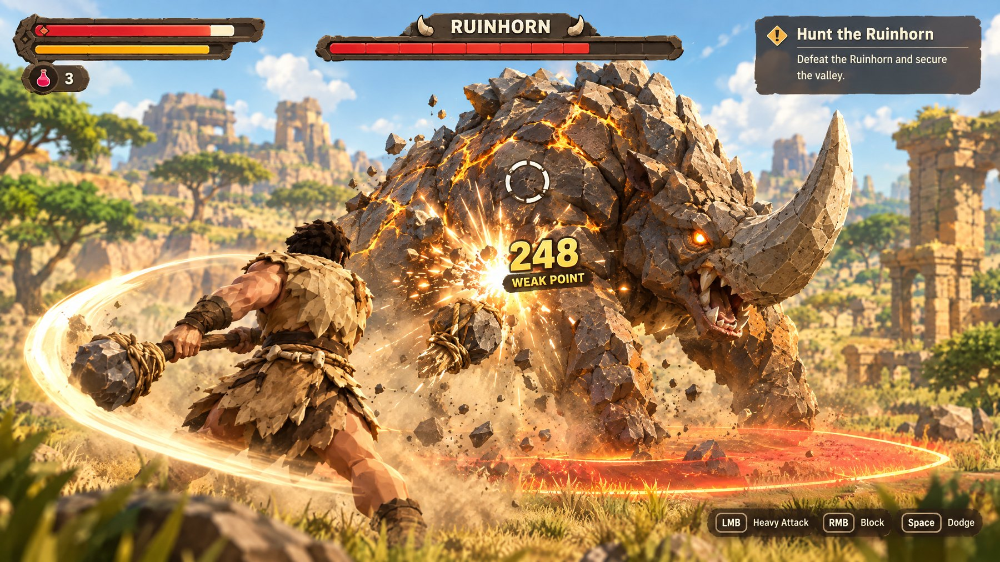
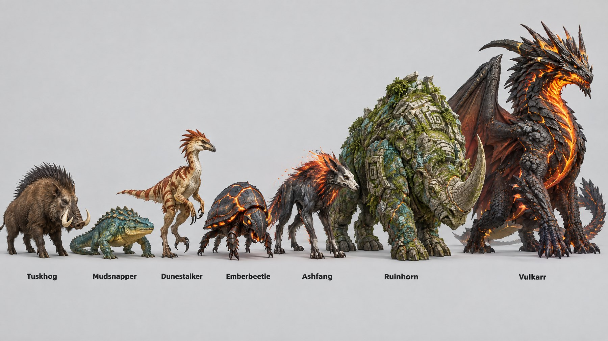
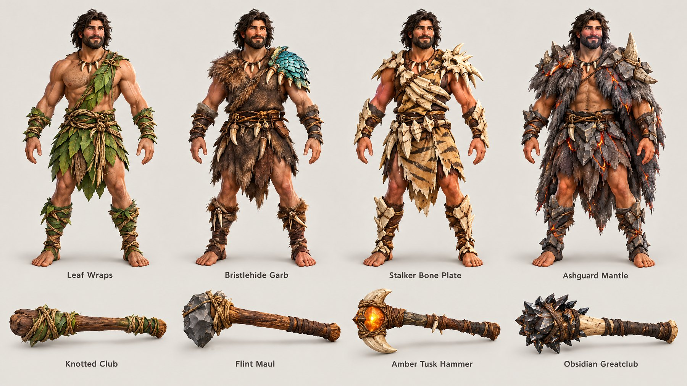
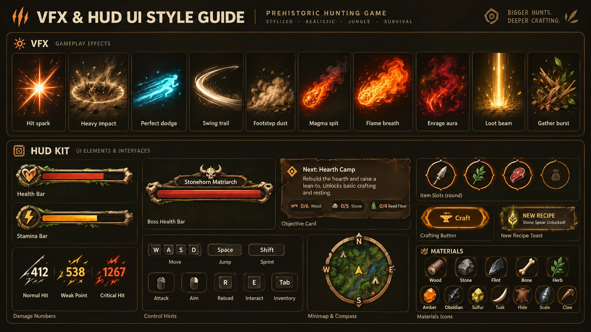

# Caveman vs Wild — "Primal Hunt" Concept Proposal

## 1. What makes the genre's best games fun

| Reference pattern | Why it works | What we take from it |
|---|---|---|
| **Monster-hunting loop**: prepare → track → fight → carve → craft ([loop analysis](https://www.kokutech.com/blog/gamedev/design-patterns/flow-state/monster-hunter-world)) | Each system feeds the next. Stress in the fight is paid off by relief and visible progress in the carve and craft. | Every hunt yields named parts that go straight into a visible gear tier or camp stage. The objective tracker always points at the next hunt. |
| **Committed, telegraphed melee** | A readable windup plus a real recovery window turn fights into pattern reading and mastery rather than button mashing. | Ground decals that fill up during the windup, a glowing "OPEN" tag during recovery, stamina-gated dodge with i-frames, and a charge heavy. |
| **Hitstop and impact** ([Wilds hitstop tuning](https://www.gamesradar.com/games/monster-hunter/monster-hunter-wilds-hitstop-feels-way-better-in-the-non-beta-build-and-players-are-thrilled/)) | Freezing a few frames on contact sells weight, most of all on heavy weapons and finishers. | Tiered hitstop (light < heavy < charged < kill), camera shake, slash arcs, impact flashes, ground cracks, and sparks tinted to the target's palette. |
| **Wounds and weak points** ([focus mode](https://www.monsterhunter.com/wilds/en-us/hunting/focus-mode/)) | Rewards aiming and positioning, and turns a "big HP bar" into distinct goals. | Part breaks (tusks, plates, crests) drop bonus parts. Stagger/topple windows follow poise damage. |
| **Bright creature-filled wilderness** | Lush, saturated, readable biomes with wildlife everywhere make exploring the reward in itself. | Three graded regions with their own palette, fog, music and ambience, plus wandering herds and landmark silhouettes you can see from far away. |
| **Game juice** (Jonasson & Purho, *Juice It or Lose It*; Nijman, *The Art of Screenshake*) | Generous, layered audio-visual feedback on every input makes simple actions feel good. | Particles on HUD events (craft, upgrade, objective, loot fly-to-satchel), footstep dust, pickup chimes, and a low-health heartbeat. |

## 2. Design pillars

1. **Postcard scenery.** Every screenshot should read as key art: layered foreground foliage, a midground trail and a landmark silhouette on the horizon.
2. **Read → Dodge → Punish.** Every enemy attack has a windup you can see and hear, an active window, and a recovery window you can punish.
3. **Every hunt pays out.** Parts fly into your satchel on screen, recipes light up when affordable, and the camp visibly grows.
4. **Weight.** Hits land with hitstop, shake, sparks, cracks and chunky SFX. Heavy attacks feel different from lights.

## 3. Concept art

| | |
|---|---|
|  World: Cinderfall Isle, three regions |  Combat HUD mock-up |
|  Bestiary line-up |  Hunter gear tiers |
|  VFX and HUD kit | |

**Art direction:** stylised realism, meaning realistic painted textures on readable silhouettes, with a warm, saturated, sunny grade. Surfaces are matte, and emission is reserved for lava, embers and gameplay signals (glare pass: no metallic surfaces, low specular, reduced bloom). The HUD is built from carved stone and bone frames in amber, charcoal and bone white.

## 4. Feature set (implemented)

### World and scenery
- Heightfield island: **Fernsong Coast** (jungle, lagoon, waterfall), **Amber Highlands** (cliffs, ruins, geysers) and **Cinder Caldera** (lava, obsidian, ash).
- Textured catalog vegetation and rocks (Quaternius *Stylized Nature MegaKit*, CC0): broadleaf jungle trees, twisted savanna trees, dead caldera trees, ferns, big-leaf plants, flowering bushes, flowers and rocks. All are instanced per chunk with wind sway. The procedural versions stay as a far LOD so nothing pops.
- Animated water with shoreline foam, flowing lava, a waterfall, a volcanic plume, clouds, per-region fog and sky blending, geysers, and ambient motes.

### Combat
- Light combo, charged heavy, stamina dodge with i-frames and a perfect-dodge flash, lock-on, and soft targeting.
- Enemies: 5 species plus 2 bosses. Each attack has a windup telegraph decal, an active window and a recovery window marked "OPEN". Poise, stagger, enrage and leashing are all in.
- Juice: tiered hitstop, camera shake, textured slash arcs, weapon swing trails, impact flashes, sparks, ground cracks, dust puffs, fire bursts, projectile trails, hurt screen shards, and damage numbers.

### Characters (generated 3D)
- Hunter: four armour tiers as rigged, textured image-to-3D meshes, with a retargeted clip library (idle, walk, run, stance, light, heavy, dodge, hit, down, gather) and weapon meshes on the hand bone.
- Creatures: textured image-to-3D meshes auto-skinned in-engine to the procedural pose rigs, which keep every telegraph animation.

### HUD and feedback
- Painted HUD: heart and stamina medallions, bone-framed bars, a boss crest, a compass ring with an objective marker, a lock-on reticle, parchment region banners, and painted item icons.
- A canvas HUD particle layer: craft, upgrade and objective bursts, loot icons flying to the satchel, hurt shards, and victory fireworks.

### Audio
- Generated SFX for combat, gathering, UI, camp upgrades and the signal fire, plus footsteps (grass and stone) and a low-health heartbeat.
- An adaptive score: region loops, explore/hunt/boss percussion layers that crossfade with combat intensity, per-region ambient beds, and a victory sting.

### Loading
- **Boot stage:** only the title and the first region (the coast: hunter T0, the first two creatures, coast vegetation, core UI and SFX) load before the title appears.
- **Background stages:** highlands, then caldera, stream in after the title, with the current and next region prioritised. Prefetch **pauses while the game is busy** (combat, high VFX counts, slow frames) and resumes when play calms down. Placeholders cover anything that hasn't arrived yet.

## 5. Loop summary
Gather at the coast → rebuild the hearth (Camp I) → hunt the coast beasts → craft a Bone Maul and hide armour → the highlands and the Ruinhorn boss → Camp II → the caldera and the Vulkarr boss → Camp III → restore the signal tower → victory.
